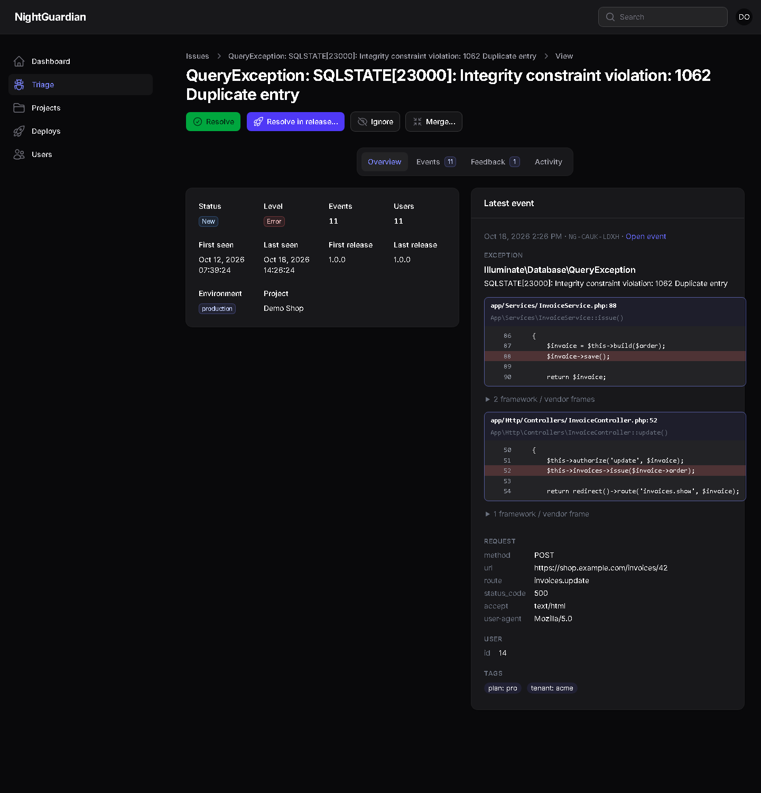
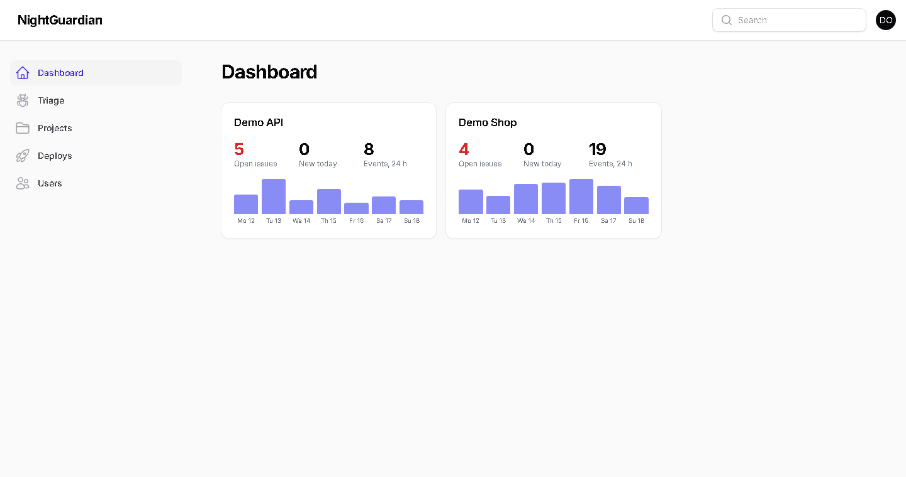
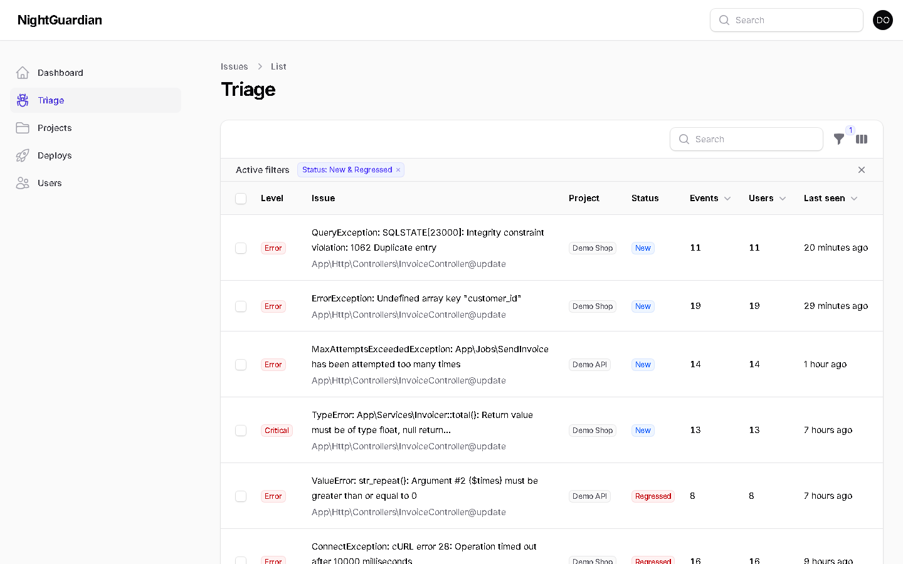
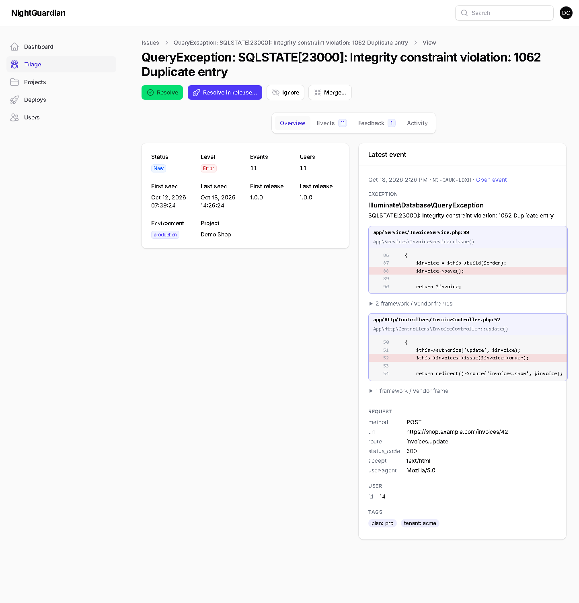
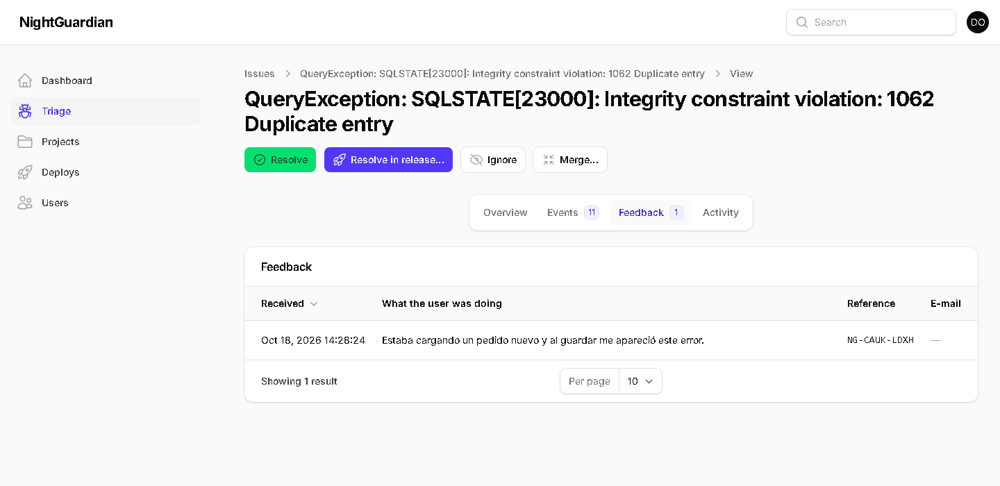
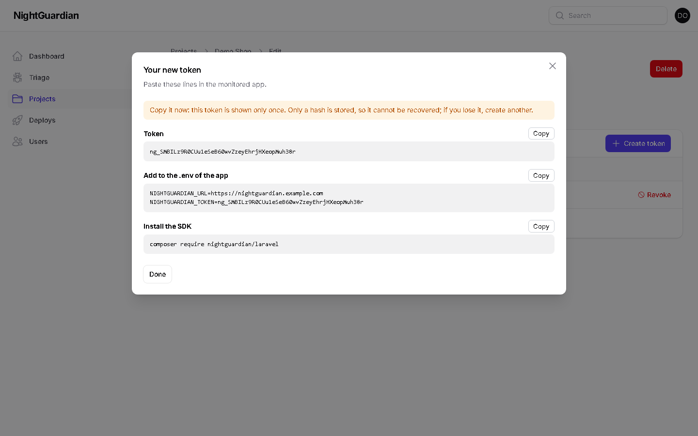
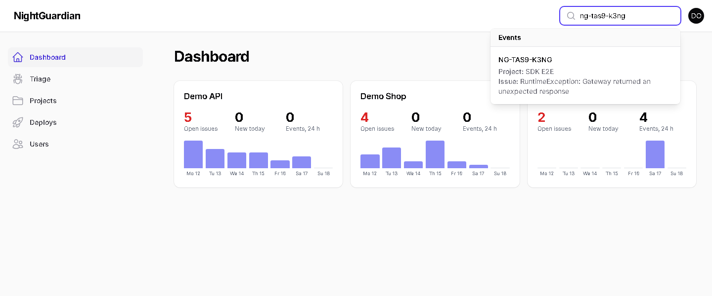

<p align="center">
  <a href="https://nightguardian.com.ar"></a>
</p>

<h1 align="center">🌙 NightGuardian</h1>

<p align="center">
  <em>Self-hosted error &amp; health monitoring for your applications. It stays awake so you don't have to.</em>
</p>

<p align="center">
  <a href="https://github.com/pablozagni/nightguardian/actions/workflows/ci.yml"></a>
  <a href="https://github.com/pablozagni/nightguardian/releases"></a>
  <a href="LICENSE"></a>
  
  
  
  <a href="https://packagist.org/packages/nightguardian/laravel"></a>
</p>

<p align="center">
  <a href="https://nightguardian.com.ar"><strong>nightguardian.com.ar</strong></a> ·
  <a href="https://nightguardian.com.ar/try">Try it live</a> ·
  <a href="README.es.md">Español</a> ·
  <a href="docs/deploy.md">Deploy</a> ·
  <a href="docs/architecture.md">Architecture</a> ·
  <a href="docs/protocol/v1.md">Protocol</a> ·
  <a href="ROADMAP.md">Roadmap</a> ·
  <a href="CONTRIBUTING.md">Contributing</a>
</p>

---

## Why NightGuardian?

Your apps break at 3 AM. You find out at 9 AM — from a customer.

Hosted monitoring tools are great, until you add up per-seat pricing, event quotas, data-residency
questions and a credit card you can never quite cancel. NightGuardian is the other option:

- **Self-hosted, free, MIT.** Your server, your database, your data. No quotas, no seats.
- **API-first.** The collector speaks a small, documented [HTTP protocol](docs/protocol/v1.md).
  Laravel is the first SDK; PHP, Node, Python — even Delphi — can follow.
- **Never breaks your app.** SDKs send *after* the response, with short timeouts, a circuit breaker
  and an on-disk queue. If the collector is down, your app doesn't notice and nothing is lost.
- **Quiet by default.** Errors are grouped into issues. You get notified when something is
  **new**, **regresses**, or **spikes** — not on every occurrence.
- **Friendly to end users.** Optional error page with a reference code (`NG-7F3K-92QD`) and a
  "what were you doing?" box, so support can find the exact error in seconds.
- **Built with Laravel + Filament.** If you know Laravel, you can contribute today.

## What it does (v0.1.1)

| | |
|---|---|
| **Capture** | Exceptions, error logs, failed jobs, failed scheduled tasks, slow requests, slow queries, deploys, user feedback |
| **Triage** | Grouping by smart fingerprint, statuses *new / regressed / resolved / ignored*, merge issues, search by reference code |
| **Alerts** | Telegram and e-mail per project, minimum level per channel, "always notify" rules, cooldowns, daily digest |
| **Access** | Multiple projects, per-project roles (admin / member / viewer), optional 2FA |
| **Privacy** | Secrets scrubbed in the SDK *and* again in the collector; IPs and request bodies off by default |
| **Retention** | Configurable per project (default 30 days); issues and counters are kept |

## The panel

| Dashboard | Triage |
|---|---|
|  |  |

| Issue detail | Feedback from users |
|---|---|
|  |  |

| Tokens (shown once, with the install snippet) | Dark mode |
|---|---|
|  |  |



- **Dashboard:** a card per project (open issues, new today, events in 24 h, 7-day chart).
- **Triage:** filter by project, status, environment, type, level and release; sort by last seen or events; resolve or ignore in bulk.
- **Issue detail:** latest event with the stack trace (in-app frames highlighted, code context), request, user, tags and context; tabs for events, **feedback** and activity; actions to resolve, resolve in a release, ignore (1 h / 24 h / forever), reopen and merge.
- **Search:** the search box finds an event by the reference code a user gives you (`NG-7F3K-92QD`, in any case, with or without dashes) and issues by title.
- **Tokens:** creating a token shows it **once**, with the two lines to paste in the app's `.env` and `composer require nightguardian/laravel`; only its hash is stored.
- **Access:** invitation links (signed, 7 days, one use) for projects and for the instance; super admins manage users.

## Running the queue and the scheduler

Alerts, digests and retention need a queue worker and the scheduler. In production use a systemd/Supervisor worker and
one cron line (`* * * * * php artisan schedule:run`). To try it locally, in two consoles:

```powershell
php artisan queue:work --tries=3
php artisan schedule:work
```

Telegram bot tokens are entered in the panel (project → *Alert channels*), stored encrypted, and never written to files.

## Quick start

**1. Run the collector** (PHP 8.3+, MySQL 8 / MariaDB 10.6+):

```bash
git clone https://github.com/pablozagni/nightguardian.git
cd nightguardian
composer install
cp .env.example .env            # then set DB_DATABASE, DB_USERNAME and DB_PASSWORD
php artisan key:generate
php artisan nightguardian:install
```

`nightguardian:install` checks the requirements, creates the tables and your first super admin. Alerts, digests and
retention need a queue worker and the scheduler: the command prints the cron line and a systemd unit, and
[docs/deploy.md](docs/deploy.md) is a copy-paste guide for **Ubuntu 22.04 + Apache + PHP-FPM + MySQL** (HTTPS, worker,
cron, updates and backups). To try it first, **Docker** is two commands away:

```bash
docker compose up -d --build
docker compose exec app php artisan nightguardian:install --skip-migrate     # then open http://localhost:8080
```

Locally, without a worker or cron: `php artisan queue:work` and `php artisan schedule:work` in two consoles.

**2. Create a project and a token in the panel**, which shows the lines to paste (once). Then, in your Laravel app (5.8 → 13):

```bash
composer require nightguardian/laravel
```

```dotenv
NIGHTGUARDIAN_URL=https://nightguardian.example.com
NIGHTGUARDIAN_TOKEN=   # created in the collector panel
```

```bash
php artisan nightguardian:test
```

That's it. Break something and watch it arrive.

## How it works

```
 Your app ──(SDK)──► spool on disk ──HTTPS, after response──► Collector API ──► MySQL
                                                                   │
                                     Filament panel ◄──────────────┤
                                     Telegram / e-mail ◄── queue ──┘
```

Read the full [architecture](docs/architecture.md).

## SDKs

| Platform | Package | Status |
|---|---|---|
| Laravel 9 – 13 | [`nightguardian/laravel`](https://github.com/pablozagni/nightguardian-laravel) 2.x | ✅ v2.0.0 |
| Laravel 5.8 – 8 | [`nightguardian/laravel`](https://github.com/pablozagni/nightguardian-laravel) 1.x | ✅ v1.0.0 |
| Plain PHP | `nightguardian/php` | 🙋 looking for a maintainer |
| Node.js | `nightguardian-node` | 🙋 looking for a maintainer |
| Python | `nightguardian-python` | 🙋 looking for a maintainer |

Want to write one? Start with [docs/sdk-authors.md](docs/sdk-authors.md). The collector has a
dry-run mode that validates your payloads.

## Contributing

NightGuardian is young, which means **your PR can shape it**. Good places to start:

- Issues labeled [`good first issue`](../../labels/good%20first%20issue)
- New alert channels (Slack, Discord, Teams, webhooks) — see [docs/alerts.md](docs/alerts.md)
- Translations (`lang/`)
- A new SDK

Read [CONTRIBUTING.md](CONTRIBUTING.md). Be kind: [Code of Conduct](CODE_OF_CONDUCT.md).
Security issues: [SECURITY.md](SECURITY.md).

## License

MIT © Pablo Zagni and contributors. Born at [z.system](https://www.z-system.com.ar), Argentina.
